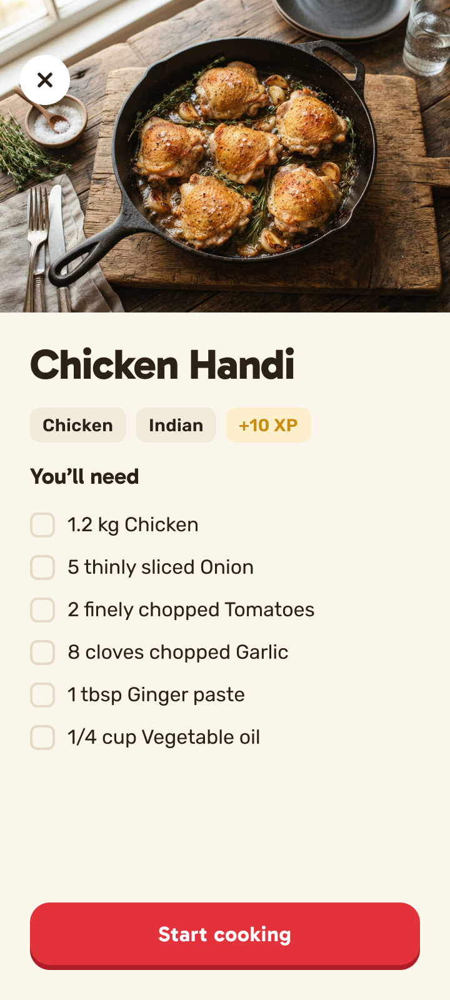

# Stovetime

**Recipes & timers for home cooks.** Know exactly when to flip, stir and rest.

Stovetime answers "how long do I cook this?" with cooking guides and timers that keep running while you cook several things at once, then grows into a recipe app with cook mode, a shopping list and your own cookbook.

## Requirements

- Android Studio, latest stable
- JDK 21. Android Studio's bundled JDK works, and Gradle downloads one if it can't find it.
- An emulator or a device on Android 10 (API 29) or later

## Getting started

Clone the repo:

```bash
git clone https://github.com/ericwafula/stovetime.git
cd stovetime
```

Then either:

- **Android Studio:** open the `stovetime` folder, let Gradle sync, pick an emulator or device and press Run.
- **Command line:** with an emulator running or a device plugged in:

  ```bash
  ./gradlew installDebug
  ```

To check everything builds without installing:

```bash
./gradlew assembleDebug
```

## Level 2: Claude Code in the repo

Same screen, same prompt, but now Claude Code can read the project. Nothing is set up yet: no skills, no agents, no `CLAUDE.md`.

The screen to build:



1. From the project folder, start Claude Code:

   ```bash
   claude
   ```

2. Run `/init` so Claude writes a `CLAUDE.md` describing the project. Read what it wrote.
3. Drag in [`assets/recipe-screen.png`](assets/recipe-screen.png), then paste this prompt:

   ```text
   Build this screen in Jetpack Compose, and add a ViewModel to handle its state.
   ```

4. When it's done, run `/context` to see how many tokens went on exploring the repo.

## Project layout

- `app/` — the Android app
- `build-logic/` — Gradle convention plugins (`stovetime.*`)

## License

Apache License 2.0. See [LICENSE](LICENSE).
