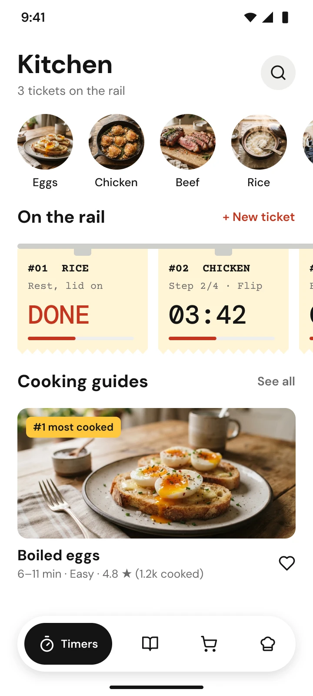

# Stovetime

**Recipes & timers for home cooks.** Know exactly when to flip, stir and rest.

Stovetime answers "how long do I cook this?" with cooking guides and timers that keep running while you cook several things at once, then grows into a recipe app with cook mode, a shopping list and your own cookbook.

## Requirements

- Android Studio, latest stable
- JDK 21. Android Studio's bundled JDK works, and Gradle downloads one if it can't find it.
- An emulator or a device on Android 10 (API 29) or later

## Getting started

Clone the repo:

```bash
git clone https://github.com/ericwafula/stovetime.git
cd stovetime
```

Then either:

- **Android Studio:** open the `stovetime` folder, let Gradle sync, pick an emulator or device and press Run.
- **Command line:** with an emulator running or a device plugged in:

  ```bash
  ./gradlew installDebug
  ```

To check everything builds without installing:

```bash
./gradlew assembleDebug
```

## Level 1: chat and copy-paste

The screen to build:



1. Open a new chat on [claude.ai](https://claude.ai).
2. Attach [`assets/kitchen-screen.png`](assets/kitchen-screen.png), then paste this prompt:

   ```text
   Build this screen in Jetpack Compose, and add a ViewModel to handle its state.
   ```

3. Claude only replies with code. Copy it into `app/`, build in Android Studio, and paste any errors back into the chat.

## Using it with Claude Code

From the project folder:

```bash
claude
```

Run `/init` once to have Claude write a `CLAUDE.md` describing the project, then ask it for whatever you want to build.

## Level 3: build the setup

This branch is the starting point for Level 3. Each step is built live:

- [ ] 1. Create a skill: Route → Screen → Content, with previews
- [ ] 2. Create a subagent: a code reviewer (read-only, Sonnet)
- [ ] 3. Manage context: `/context`, `/compact`, `/clear`
- [ ] 4. Control cost: models and effort levels
- [ ] 5. Plan: turn a requirement into acceptance criteria
- [ ] 6. Verify: checks, a Maestro flow, and the Figma and Mobile MCP servers in `.mcp.json`
- [ ] 7. See it all together: `git checkout workshop/level-3-complete`

Skills and agents go in `.ai/skills/` and `.ai/agents/`. Run `.ai/setup.sh` after adding one so Claude Code can find it.

## Project layout

- `app/` — the Android app
- `build-logic/` — Gradle convention plugins (`stovetime.*`)
- `.ai/` — the roadmap, and the skills and agents you add

## License

To be decided.
