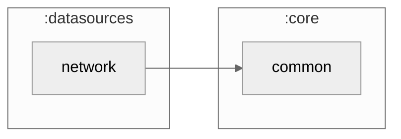

# :datasources:network

The Ktor client for TheMealDB: categories, meals in a category, search by name and lookup by id. Every operation is a `fun interface` returning `NetworkResult<Dto>`, grouped by `RecipesRemoteDatasource` and bound in `NetworkModule`. The base URL, including the free key, is the `MEALDB_BASE_URL` build config field in `build.gradle.kts`.

### Module dependency graph

