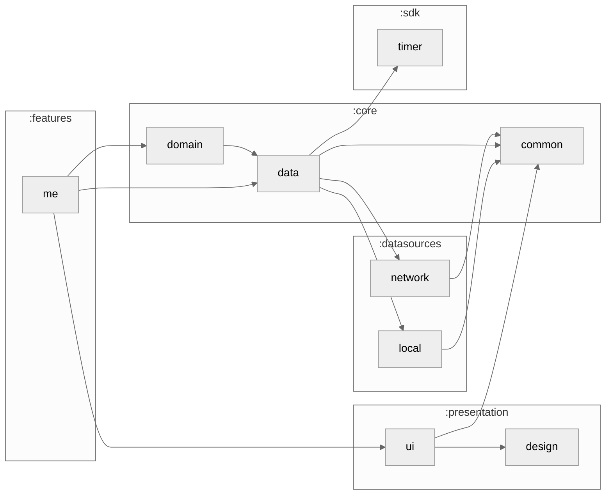

# :features:me

The Me tab: total XP, the current and best week streak, this week's cooks against the goal, the cook settings and the history of everything cooked. Progress comes from the rules in `:core:domain`; settings are read and saved through `:core:data`.

### Module dependency graph

