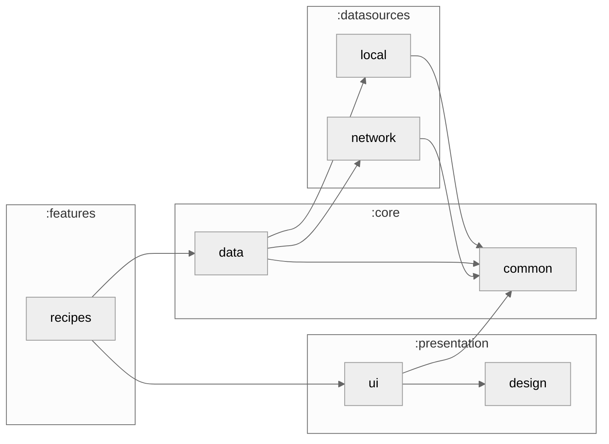

# :features:recipes

The Recipes tab: browse and search the catalogue synced from TheMealDB, and the recipe page with its ingredients. Screens read only from `:core:data`, which keeps the phone's copy fresh in the background.

### Module dependency graph

