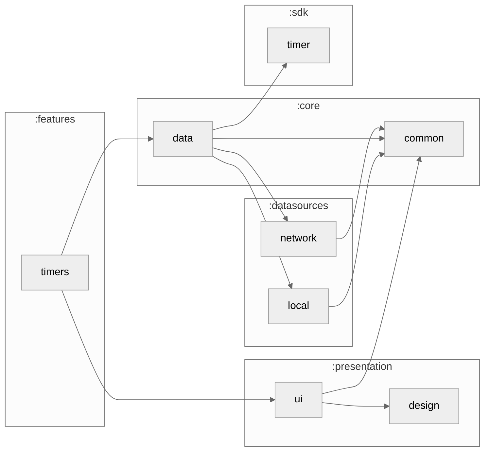

# :features:timers

The Timers tab and the alarm. Every running timer in one list with pause, "+1 min" and cancel, quick timers that aren't part of a lesson, and the full-screen alarm `:app` shows over the lock screen when a timer ends. Screens read and drive timers only through `TimersRepository` in `:core:data`.

### Module dependency graph

